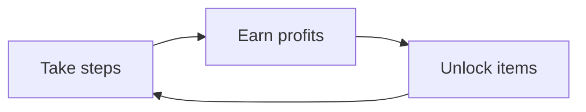

# Core Loop

- Take steps: Taking steps "serves" an item, thus earning profits.
- Earn profits: When a player serves an item, they gain currency which they can use to unlock items
- Unlock items: An item can be unlocked by paying a certain amount, but needs a specific number of steps in order to serve to customers
# Controls & Player Actions
- **Camera View:** 2D static 
- **Movement Profile:** Menu-based navigation

| Input | Action             | Context / Notes                                               |
| ----- | ------------------ | ------------------------------------------------------------- |
| Steps | [[Step Counter]]   | Counts the number of steps of the player in order to progress |
| Taps  | [[UI Interaction]] | Clicks different buttons to open menus, select upgrades, etc. |

## Game Rules & Logic
- **Win Condition**: Reaching the target number of steps, earning a high amount of currency, and unlocking all items
- **Fail Condition:** No strict failure condition
- **Failure Penalty:** Progress is paused
- **Save & Persistence System:** Autosaves currency on exit, each unlockable has its own step progress
