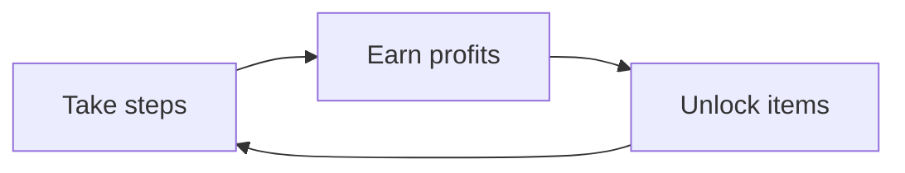

# Core Loop
> [!info] Guideline
> Map the primary cyclical sequence of gameplay actions, rewards, and progression steps. What does the player do repeatedly every 2 to 5 minutes?
> > [!tip] You can create your flowcharts using [mermaid](https://mermaid.js.org/) or [draw.io](https://draw.io) as they are compatible within Obsidian. (draw.io requires a community plugin)

- Take steps: Taking steps "serves" an item, thus earning profits.
- Earn profits: When a player serves an item, they gain currency which they can use to unlock items
- Unlock items: An item can be unlocked by paying a certain amount, but needs a specific number of steps in order to serve to customers

> [!hint] You can link each action to its own page.
# Controls & Player Actions
> [!info] Guideline
> Map system inputs to specific in-game actions, output behavior, and operational constraints.
> > [!tip] Attach an image of the controller you wish to use with the actions mapped out.

- **Camera View:** 2D static
- **Movement Profile:** Menu-based navigation

| Input | Action             | Context / Notes                                               |
| ----- | ------------------ | ------------------------------------------------------------- |
| Steps | [[Step Counter]]   | Counts the number of steps of the player in order to progress |
| Taps  | [[UI Interaction]] | Clicks different buttons to open menus, select upgrades, etc. |

## Game Rules & Logic
> [!info] Guideline
> Define the operational boundary rules, victory/defeat criteria, and state-persistence systems governing the game session.
- **Win Condition**: Reaching the target number of steps, earning a high amount of currency, and unlocking all items
- **Fail Condition:** No strict failure condition
- **Failure Penalty:** Progress is paused
- **Save & Persistence System:** Autosaves currency on exit, each unlockable has its own step progress
